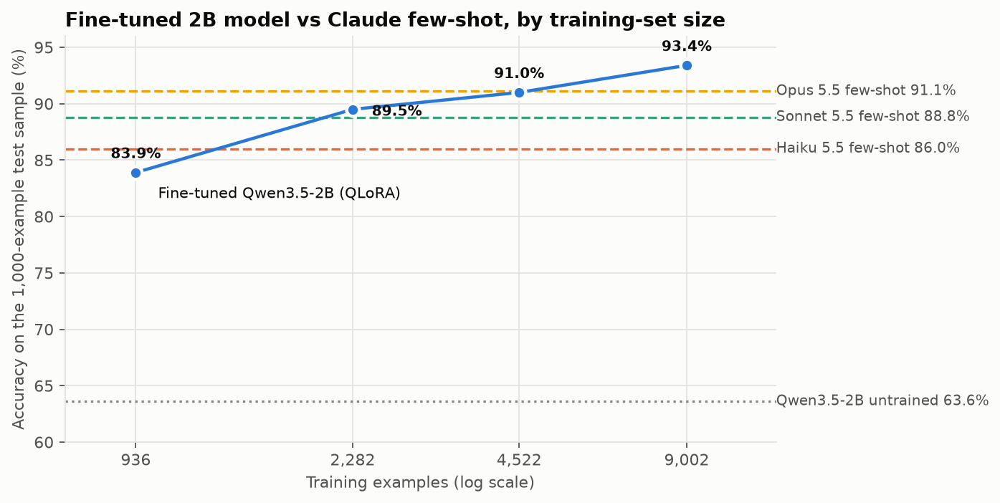
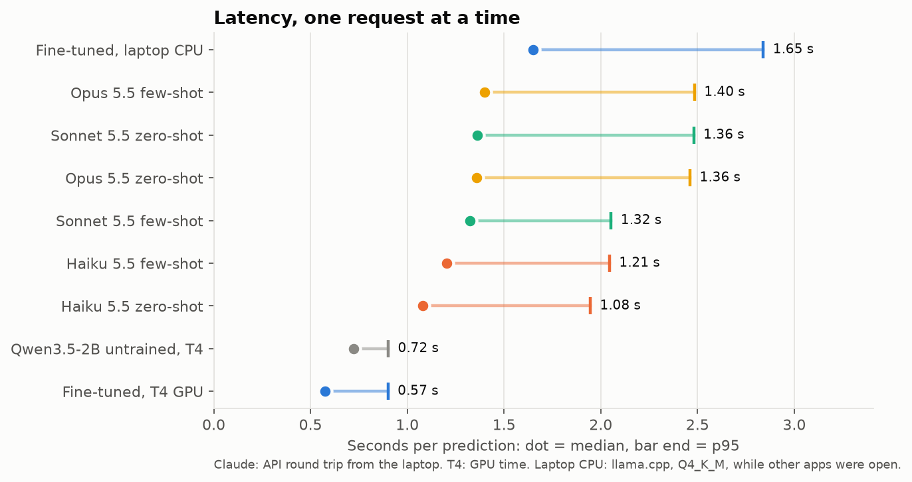
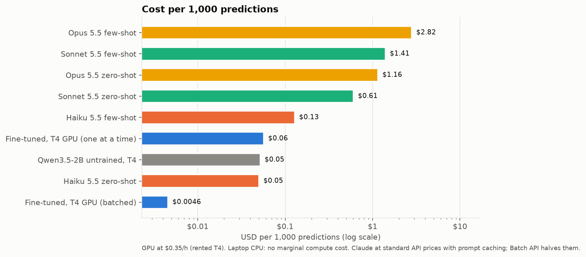
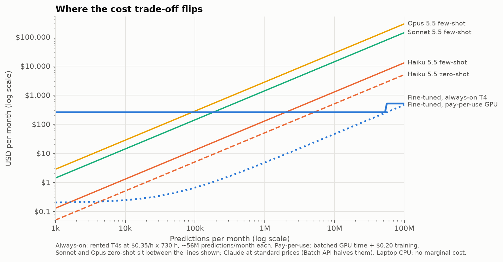

# small-vs-frontier: report

**Question.** On a narrow task (Banking77, 77-way intent classification of customer messages), when does a
small open model fine-tuned with QLoRA beat Claude Haiku 5.5, Sonnet 5.5 and Opus 5.5 on accuracy, latency and
cost?

**Short answer.** With the full 9,002 training examples, a fine-tuned Qwen3.5-2B is the most accurate system
tested: 93.4% on a fixed 1,000-example test sample, against 91.1% for the best Claude setup (Opus 5.5 few-shot).
The gap is statistically significant. Compressed to 4 bits it runs on an ordinary laptop CPU at the same
accuracy. On cost, it is about 11x cheaper per prediction than the cheapest Claude setup *when requests are
batched on a GPU*. Rented as an always-on server it only beats Claude above certain monthly volumes, and below
roughly 5 million predictions a month Haiku zero-shot is the cheaper option.

All numbers below are reproducible from `results/summary/` (`make eval`, `make report`). Prices were checked on
2026-10-13 (`configs/pricing.yaml`).

## Setup

| | |
|---|---|
| Data | Banking77 from PolyAI's CSVs, pinned by commit and sha256. Stratified 10% validation hold-out from train (seed 42). Every model is scored on the same stratified 1,000-example test sample; the best fine-tuned model also on the full 3,080. |
| Claude | Haiku / Sonnet / Opus 5.5. Zero-shot (instructions + the 77 labels with one-line descriptions) and few-shot (+ 3 training examples per label). Structured output constrained to the 77 label names, `effort: low`, cached system prompt. |
| Small model | Qwen3.5-2B (Apache-2.0), chosen over Gemma 4 E2B and Phi-4-mini on memory and speed (`results/summary/phase3_model_probe.json`). QLoRA r=16 on every language-model projection, 3 epochs, prompt = one short instruction + the message (no label list), loss on the label tokens only. |
| Hardware | Training and GPU inference: Colab Tesla T4, priced at a rented-T4 rate of $0.35/h. CPU inference: the laptop's Intel i5-1135G7, 4 threads, llama.cpp via llama-cpp-python 0.3.36, Q4_K_M GGUF (1.27 GB). |

## Results (1,000-example test sample)

| System | Accuracy | Macro-F1 | Median latency | Cost per 1k |
|---|---|---|---|---|
| Fine-tuned Qwen3.5-2B, laptop CPU (Q4_K_M) | 93.8% | 0.939 | 1.65 s | $0 marginal |
| Fine-tuned Qwen3.5-2B, T4 GPU (4-bit) | 93.4% | 0.935 | 0.57 s | $0.0046 batched |
| Claude Opus 5.5 few-shot | 91.1% | 0.910 | 1.40 s | $2.82 |
| Claude Opus 5.5 zero-shot | 88.9% | 0.883 | 1.36 s | $1.16 |
| Claude Sonnet 5.5 few-shot | 88.8% | 0.887 | 1.32 s | $1.41 |
| Claude Sonnet 5.5 zero-shot | 86.4% | 0.858 | 1.36 s | $0.61 |
| Claude Haiku 5.5 few-shot | 86.0% | 0.858 | 1.21 s | $0.13 |
| Claude Haiku 5.5 zero-shot | 81.8% | 0.811 | 1.08 s | $0.050 |
| Qwen3.5-2B untrained (zero-shot, T4) | 63.6% | 0.631 | 0.72 s | $0.052 |

On the full 3,080-example test set the fine-tuned model scores 94.0% (macro-F1 0.941). Claude's Batch API
halves its prices; latency is one request at a time (Claude: API round trip from the laptop).

## Where each one wins

**Accuracy: the fine-tuned model.** Paired McNemar tests on the same 1,000 examples
(`results/summary/comparison.json`) put it ahead of every Claude run. The closest is Opus few-shot: the
fine-tuned model was right on 48 examples Opus got wrong and wrong on 25 that Opus got right (p = 0.0095). Against
Haiku zero-shot the split is 139 vs 23. Training data is what makes it work: the same model untrained scores
63.6%, and it needs about a quarter of the training set (2,282 examples, 89.5%) to pass Sonnet few-shot.

**Quantisation costs nothing measurable.** The 4-bit GGUF on the laptop and the 4-bit model on the T4 disagree
on 18 of 1,000 examples, 11 to the laptop's favour and 7 to the GPU's (p = 0.48).

**Latency: the GPU, then Claude, then the laptop.** One request at a time, the T4 answers in 0.57 s (median), the
Claude API in 1.1-1.4 s and the laptop CPU in 1.65 s (p95 2.84 s). The laptop figure was measured while
browsers and other apps were using the CPU; an idle run during the API test was close to 1 s.

**Simplicity and zero setup: Claude.** No training data, GPU or model files. Few-shot gains 2-4 points over
zero-shot for every Claude model, and every Claude output was a valid label.

## Where the cost trade-off flips

Training the best model took 34 minutes on the T4 (about $0.20); the whole 4-run sweep about $0.37.

- **Pay-per-use GPU, batched** (you pay only for GPU time while predicting, 21 predictions/s at batch 64):
  $0.0046 per 1k, about 11x below Haiku zero-shot. The one-off training cost is recovered after about 4,300
  predictions against Haiku zero-shot, or 70 against Opus few-shot.
- **Pay-per-use GPU, one request at a time:** $0.057 per 1k, no cheaper than Haiku zero-shot. Without batching
  the GPU advantage disappears.
- **Always-on rented T4** ($0.35/h x 730 h = $256/month, up to ~56 million predictions/month): cheaper than
  Claude only above about **91k predictions/month vs Opus few-shot**, 182k vs Sonnet few-shot, 2.0M vs Haiku
  few-shot and **5.1M vs Haiku zero-shot**. Below those volumes the API is cheaper.
- **A machine you already own** (the laptop): no marginal compute cost, at 0.56 predictions/s on 4 cores.

These are compute costs only. They leave out the engineering time to build, monitor and retrain a model, which
usually dominates at low volume.

## Error analysis

The models fail on the same handful of near-synonymous intents. The most frequent confusions:

| Fine-tuned (T4) | Opus 5.5 few-shot | Haiku 5.5 zero-shot |
|---|---|---|
| card_payment_not_recognised -> compromised_card (3) | fiat_currency_support -> exchange_via_app (5) | get_physical_card -> change_pin (9) |
| fiat_currency_support -> exchange_via_app (2) | card_payment_not_recognised -> compromised_card (5) | beneficiary_not_allowed -> declined_transfer (6) |
| compromised_card -> lost_or_stolen_card (2) | reverted_card_payment? -> declined_card_payment (4) | why_verify_identity -> verify_my_identity (5) |
| reverted_card_payment? -> declined_card_payment (2) | direct_debit_payment_not_recognised -> card_payment_not_recognised (3) | topping_up_by_card -> top_up_by_card_charge (5) |

The shared pairs (an unrecognised payment vs a compromised card, which currencies are supported vs exchanging
in the app, a reverted vs a declined payment) are ambiguous in the labels themselves; several test messages could
fairly carry either label. The fine-tuned model makes the same kinds of mistake, just fewer of them: it has learnt
the annotators' conventions for these boundaries from the training data, which a label description can't fully
convey. The untrained Qwen's errors are different in kind: 4.6% of its answers were invented label names.

## Caveats

- **One dataset, one seed, one test sample.** 1,000 examples give roughly ±1.5-2 points of sampling error per
  system; the paired tests account for this when comparing two systems.
- **Train/test overlap:** 7 test messages appear word for word in the training data (2 in the 1k sample). They
  were kept so results stay comparable with published Banking77 numbers.
- **The T4 computes Qwen3.5 in float32** (fp16 overflows on this architecture and the T4 has no bfloat16), so a
  bf16-capable GPU such as an L4 would be faster. GPU prices are a market rate for a rented T4, not what Colab
  charged (nothing).
- **Claude ran at `effort: low`** for parity (thinking can't be turned off on Opus 5.5). Thinking used almost no
  tokens (17-27 output tokens per call). Higher effort might add accuracy at higher cost; that was not tested.
- **Latency depends on the network** for Claude (a brief network drop delayed 4 Sonnet calls; medians and p95 are
  used) and on background load for the laptop.
- **Engineering effort isn't priced.** The comparison is compute only.

## What went wrong along the way (and the fixes)

- The Hugging Face copy of Banking77 is a loading script current `datasets` no longer runs: data now comes from
  PolyAI's CSVs, pinned and hash-checked.
- Qwen3.5's config only registers `<|endoftext|>` as end-of-sequence, so the fine-tuned model kept generating
  after its label. Generation now also stops at `<|im_end|>`.
- Unsloth's 16-bit merge upcast to float32 and ran Colab out of RAM; the merge now runs on CPU in bfloat16.
- The converted GGUF declared a multi-token-prediction layer whose weights were never exported, so llama.cpp
  refused it. `scripts/fix_gguf_nextn.py` fixes such files; `scripts/merge_and_gguf.py` now prevents it.
